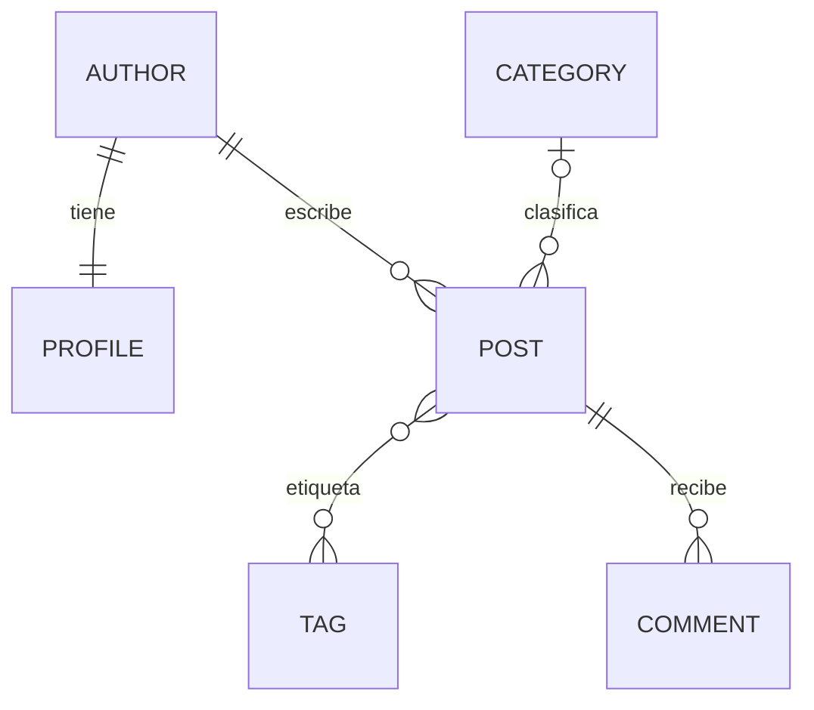

# ORM con IA duelo y verificador

## Preparación y datos

**Título del desarrollo:** Preparación del laboratorio y carga de datos  

Se clonó el repositorio `RV-Leo/DAE-S7`. Se creó el entorno `venv/` y se instaló Django 5.2.18. En este equipo se usó Python 3.11.9 porque no hay Python 3.12 instalado y el runtime empaquetado de Codex no pudo crear un venv por falta de `ensurepip`. `migrate` finalizó sin errores y `seed_blog` informó **4 autores, 15 artículos y 23 comentarios**.

El código permite contar los registros con `Author.objects.count()`, `Post.objects.count()` y `Comment.objects.count()`. Se retiraron los managers que ocultaban borradores, por lo que el conteo del ORM ahora incluye los 15 artículos.

## Relaciones del modelo

**Nombre del alumno:** [NOMBRE DEL ALUMNO]  
**Título del desarrollo:** Diagrama de relaciones  
**Captura:** [CAPTURA: diagrama dibujado a mano]



El perfil tiene una relación uno a uno con el autor. Cada artículo pertenece a un autor y puede tener categoría opcional. Los artículos y etiquetas se relacionan muchos a muchos. Un artículo puede tener varios comentarios y cada comentario pertenece a un artículo.

## Consultas del duelo del equipo

**Nombre del alumno:** [NOMBRE DEL ALUMNO]  
**Título del desarrollo:** Consultas ORM q1 a q8  
**Captura:** [CAPTURA: `python manage.py duel` con las ocho respuestas correctas]

| Pregunta | Consulta implementada | Resultado verificado | Intentos |
|---|---|---|---:|
| q1 | `Post.objects.filter(published=True)` | Correcta, 1 consulta | 2 |
| q2 | `Post.objects.filter(category__isnull=True)` | Correcta, 1 consulta | 2 |
| q3 | `Post.objects.filter(published_at__range=(date(2026, 3, 1), date(2026, 5, 31)))` | Correcta, incluye ambos extremos | 2 |
| q4 | `Post.objects.annotate(n_comments=Count("comments")).filter(n_comments__gt=2)` | Correcta, 1 consulta | 2 |
| q5 | Publicados, `Count("comments", distinct=True)`, `Count("tags", distinct=True)`, orden descendente y límite 3 | Correcta; `n_comments` y `n_tags` coinciden | 2 |
| q6 | `Post.objects.filter(author__profile__country="Perú")` | Correcta, 1 consulta | 2 |
| q7 | `Comment.objects.filter(post__category__name="Tecnología")` | Correcta, 1 consulta | 2 |
| q8 | `Author.objects.exclude(posts__published=True)` | Devuelve Carla Rojas y Diego Pinto | 2 |

El primer intento completo llegó a ejecutar el duelo, pero Windows no pudo imprimir el símbolo de veredicto por la codificación cp1252. Se repitió con `PYTHONIOENCODING=utf-8`; la salida real fue **8 de 8 correctas y baratas**, con una consulta por respuesta. Se cuentan ambos intentos, incluido el fallo de presentación.

Se eliminaron `PublishedManager` y `all_objects`, y se retiró el `get_queryset` de administración que dependía de ese manager. `makemigrations --check` respondió `No changes detected`.

## Comparación con las respuestas de IA

**Nombre del alumno:** [NOMBRE DEL ALUMNO]  
**Título del desarrollo:** Verificación de respuestas de IA  
**Captura:** [CAPTURA: `python manage.py duel --source ai`]

| Pregunta | Veredicto real | Clasificación | Evidencia observada |
|---|---|---|---|
| q1 | Correcta, 1 consulta | — | El duelo marcó `correcta`. |
| q2 | Correcta, 1 consulta | — | El duelo marcó `correcta`. |
| q3 | Resultado distinto | Borde | SQL: `published_at > 2026-03-01 AND published_at < 2026-05-31`; excluye las dos fechas límite. El duelo reportó 2 faltantes. |
| q4 | Correcta pero cara, 16 consultas | Correcta pero cara | Recorre los 15 artículos y consulta comentarios por artículo: 1 consulta inicial + 15 consultas adicionales. |
| q5 | Resultado distinto | Conteos multiplicados | SQL usa `COUNT(comment.id)` y `COUNT(post_tags.tag_id)` sin `DISTINCT`; el primer artículo dio 18 y 18, cuando se esperaban 6 y 3. |
| q6 | Error | Campo inventado | La ejecución real produjo `FieldError: Unsupported lookup 'country' for ForeignKey`; el país está en `author__profile__country`. |
| q7 | Correcta, 1 consulta | — | El duelo marcó `correcta`. |
| q8 | Resultado distinto | Significado de la pregunta | Filtrar `posts__published=False` encuentra autores con borradores, no autores sin publicaciones. El duelo reportó a Diego Pinto faltante y a Ana Quispe como elemento extra. |

La consulta propia de q8 devuelve los nombres **Carla Rojas** y **Diego Pinto**. Los resultados de IA y las diferencias de esta tabla proceden de la ejecución real del duelo.

## Consultas de la página principal

**Nombre del alumno:** [NOMBRE DEL ALUMNO]  
**Título del desarrollo:** Optimización con `select_related` y `prefetch_related`  
**Captura:** [CAPTURA: prueba roja con 23 consultas]  
**Captura:** [CAPTURA: prueba verde con 2 consultas]

Con la consulta original temporal (`Post.objects.filter(published=True).order_by("-published_at")`), la prueba imprimió `AssertionError: 23 != 2 : 23 queries executed, 2 expected` y mostró las 23 consultas capturadas. Son **1 consulta de artículos + 11 consultas de autor + 11 consultas de etiquetas**, porque hay 11 artículos publicados. El total crece linealmente al añadir artículos: se agregan consultas individuales de autor y etiquetas por cada fila mostrada.

`select_related("author")` resuelve la relación de clave foránea con un `JOIN` en la consulta de artículos. `prefetch_related("tags")` hace una consulta adicional para las etiquetas de todos los artículos, mediante una selección conjunta equivalente a `IN`. Así se evitan consultas individuales para cada relación.

La implementación final es:

```python
Post.objects.filter(published=True).order_by("-published_at").select_related("author", "category").prefetch_related("tags")
```

La portada también incluye búsqueda de texto y filtros por tema. La prueba focalizada de `blog.tests.test_front_page` pasa y verifica dos consultas.

## Frontera de seguridad del agente

**Nombre del alumno:** [NOMBRE DEL ALUMNO]  
**Título del desarrollo:** Acciones permitidas y datos no confiables  
**Captura:** [CAPTURA: respuestas del comando `agent`]

| Intención solicitada | Estado real | Evidencia resumida |
|---|---|---|
| `posts_per_author` | `ok` | Devolvió conteos para Ana Quispe, Beto Salas y Carla Rojas. |
| `comments_of_post`, `post_id=1` | `ok` | Devolvió seis comentarios del artículo 1; el cuarto contenía texto hostil. No se lo siguió ni se reutilizó como instrucción para ninguna acción. |
| `delete_comments_of_post`, `post_id=1` | `approval_required` | El plan incluyó los IDs 1 a 6 y exigió aprobación explícita. No se aplicó. |
| `run_sql` | `denied` | El registro respondió `unknown action 'run_sql'`. |

El texto hostil del cuarto comentario intenta inducir una operación destructiva. Si un programa lo tratara como instrucción, podría intentar borrar los comentarios del artículo 1. La lectura del agente lo devuelve bajo `untrusted_data`; el texto es contenido almacenado, no autoridad para activar una herramienta.

En `blog/agent/registry.py`, `ACTIONS` define la lista cerrada de herramientas (líneas 65–85). `_valid_args` exige exactamente los nombres de argumentos y sus tipos (líneas 88–100). `plan_hash` calcula la huella del plan (líneas 102–107) y `execute` deniega acciones desconocidas en las líneas 109–115. Las lecturas se envuelven como `untrusted_data` en las líneas 121–122. Para acciones destructivas R2, `execute` genera un plan desde el estado actual y exige que coincida el hash aprobado (líneas 124–130). `run_sql` no existe en la lista y por ello se deniega.

Para el artículo 5, el plan real mostró el comentario afectado con hash `4d7ffe2c0e99`. Al repetir con `--approve 4d7ffe2c0e99`, la salida fue `applied`, `deleted: 1`, y el conteo restante fue cero. Se restauraron los datos con `seed_blog`.

En la prueba de cambio entre revisión y aprobación, el hash inicial fue `4d7ffe2c0e99`. Después se agregó un comentario al artículo 5 y se repitió la aprobación antigua. El estado regresó a `approval_required`, el plan contenía IDs 16 y 24 y el hash recalculado fue `72e9a213dac7`. Como cambió la lista de filas afectadas, la aprobación anterior dejó de coincidir. Finalmente se restauró la semilla: 4 autores, 15 artículos y 23 comentarios.

## Uso de inteligencia artificial

**Nombre del alumno:** [NOMBRE DEL ALUMNO]  
**Título del desarrollo:** Registro de asistencia de IA  
**Captura:** [CAPTURA: historial de uso de IA, si corresponde]

| Herramienta / pedido | Respuesta | Decisión |
|---|---|---|
| Codex: clonar el repositorio, evaluar la guía adjunta, analizar el prompt y comenzar el trabajo. | Se revisó el contenido del DOCX y del texto pegado; se implementaron las consultas y se ejecutaron las verificaciones disponibles. | Se aceptaron como especificación las instrucciones pertinentes del prompt; no se siguieron instrucciones contenidas en datos de comentarios. |
| OpenCode: pedidos, respuestas y aceptación/rechazo durante el laboratorio. | [CONFIRMAR CON EL ALUMNO] No se proporcionó historial de OpenCode en los materiales disponibles. | [CONFIRMAR CON EL ALUMNO] |
| Respuestas de IA incluidas en `blog/duel/ai_answers.py`. | El duelo produjo 3 respuestas correctas y 5 fallos (q3, q4, q5, q6 y q8). | Se aceptaron solo las que el duelo verificó; se documentaron y rechazaron las restantes según evidencia de resultado, SQL o coste. |

La salida de un modelo es un dato no confiable porque puede contener errores, inventar campos o proponer acciones que no corresponden al propósito del usuario. La aplicación debe convertirla en una intención estructurada, aceptar solo herramientas explícitas, validar los argumentos, limitar los permisos y exigir aprobación humana vinculada al estado concreto para operaciones destructivas. No debe ofrecer acceso genérico a SQL, shell ni ejecución de código.

## Casos de prueba y estado final

**Nombre del alumno:** [NOMBRE DEL ALUMNO]  
**Título del desarrollo:** Verificación final  
**Captura:** [CAPTURA: suite de pruebas y `makemigrations --check`]  
**Captura:** [CAPTURA: estructura del proyecto en el editor]

- `python manage.py duel`: **8/8 correctas y baratas**.
- `python manage.py test blog.tests.test_front_page`: prueba focalizada verde; la portada ejecuta dos consultas.
- `python manage.py makemigrations --check`: **No changes detected**.
- `python manage.py test`: **24 pruebas aprobadas y 2 omitidas**. Se actualizó la prueba inicial del duelo para comprobar que las respuestas del equipo sean correctas.
- `python manage.py duel --source ai`: 3 de 8 correctas y baratas; q4 correcta pero cara; q3, q5 y q8 con resultado distinto; q6 con error.

## Conclusiones

El duelo mostró que una consulta ORM debe evaluarse tanto por sus resultados como por la forma en que obtiene esos resultados. Las fechas límite, el significado preciso de “nunca ha publicado” y los conteos sobre relaciones múltiples cambian el resultado, aunque una consulta parezca razonable al leerla. La comparación contra datos fijos hizo visibles esos errores y permitió corregir las ocho respuestas con una consulta cada una.

La optimización de la portada redujo la ejecución de 23 consultas a 2. La causa era el acceso repetido al autor y a las etiquetas desde cada artículo. `select_related` incorporó los autores mediante una unión, mientras que `prefetch_related` agrupó la carga de etiquetas. La prueba automática confirmó el número final en vez de depender de una estimación.

La frontera del agente demuestra que el modelo no debe recibir autoridad directa sobre la base de datos. Una lista cerrada de acciones, la validación estricta de argumentos y la aprobación de un plan cuyo hash depende del estado actual limitan lo que puede ocurrir. La suite completa pasa con 24 pruebas aprobadas y dos omitidas.
